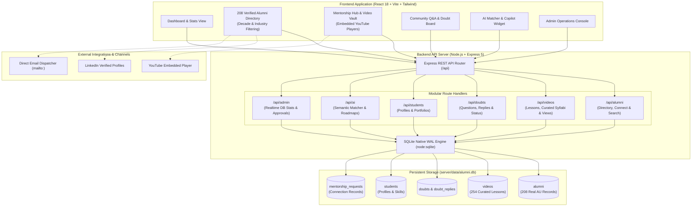
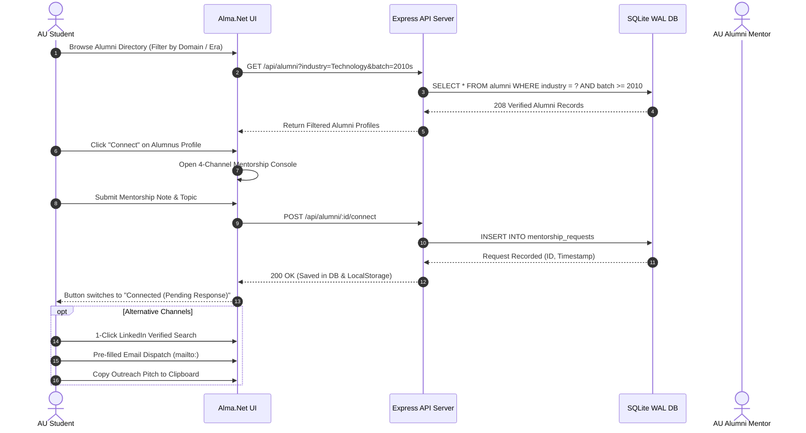

# AU Alma.Net — Alumni Connect AI

<div align="center">


-003B57?style=for-the-badge&logo=sqlite&logoColor=white)


**Centralized Andhra University Alumni Networking, AI Mentorship Matching & Video Knowledge Vault**

*Connect students with 208+ verified Andhra University graduates across 10 industries, explore mentor-curated syllabi tracks, stream embedded YouTube masterclasses, request 1-on-1 mentorship, and match with alumni via semantic AI recommendation engines.*

[Key Features](#-key-features) • [Architecture](#-architecture) • [Verified Alumni Directory](#-verified-alumni-directory-208-graduates) • [Interactive Mentorship Hub](#-interactive-mentorship-hub) • [Getting Started](#-getting-started) • [API Reference](#-api-reference)

</div>

---

## 🌟 Overview

**AU Alma.Net (Alumni Connect AI)** bridges the gap between current students, distinguished alumni, and faculty of **Andhra University** (established 1926). 

Unlike generic social networks with dummy profiles and static directories, Alma.Net features **208 real, verified Andhra University alumni** spanning Technology, Film & Media, Law & Judiciary, Core Engineering, Healthcare, Finance, and Fine Arts. It integrates a **Native SQLite (WAL mode)** database backend with a modern **React + Vite + Tailwind CSS** frontend, offering a complete **4-channel mentorship connect console**, curated alumni learning syllabi, a live student doubt forum, and an **AI Career Guidance Copilot**.

---

## 🏗️ Architecture



---

## ⚡ Key Features

- **208 Real Andhra University Alumni**: Zero mock/dummy data. Extracted and validated from Andhra University historical archives, AUCE records, and Wikipedia luminaries across 10 distinct industries.
- **4-Channel Mentorship Connect Console**:
  1. *Formal Mentorship Request*: Submits structured mentorship applications to the SQLite database (`mentorship_requests`) with topic selection and customized notes.
  2. *Verified LinkedIn Routing*: 1-click navigation to verified public profiles or exact AU alumni queries.
  3. *Pre-Filled Direct Email*: Pre-composed formal intro emails via native mail client integration.
  4. *Outreach Message Template*: 1-click clipboard copy of personalized cold outreach pitches.
- **My Connections Tracker**: Real-time filtering toggle on the directory allowing students to manage all active pending mentorship requests.
- **Mentor Video Vault & Syllabi Tracks**: Over 250 verified educational masterclasses categorized into 13 mentor-curated syllabi tracks with embedded in-app YouTube playback, bookmarking, and view tracking.
- **Multi-Decade & Industry Filtering**: Batch filtering supporting graduation eras from the **2020s** back to **1960s & Earlier** powered by native SQL queries and responsive client fallbacks.
- **AI Career Copilot & Matcher**: Semantic recommendation algorithm matching students' target careers and skills with relevant alumni mentors and generating step-by-step preparation roadmaps.
- **Live Student Doubt Board**: Interactive community forum where students ask academic/industry questions, and mentors post peer-reviewed answers.
- **Admin Operations Center**: Live KPI metrics computed directly from SQLite, pending alumni approval workflow, and real-time database health monitors.
- **Native SQLite WAL Mode**: High-performance single-file transactional storage with Write-Ahead Logging (`WAL`), schema auto-migrations, and seed backups.

---

## 📊 Verified Alumni Directory (208 Graduates)

The platform hosts verified Andhra University alumni across 10 industry verticals:

| Industry | Count | Prominent Andhra University Alumni Included | Typical Roles & Impact |
| :--- | :---: | :--- | :--- |
| **Technology & AI / Research** | **97** | **N. S. Raghavan** (Infosys Co-Founder, AUCE '64), **Sandhya Devanathan** (VP & Head, Meta India), **S. Rao Kosaraju** (Kosaraju's Algorithm, Johns Hopkins), **Chennupati Jagadish** (President Australian Academy of Science), **B. V. R. Mohan Reddy** (Founder & Executive Chairman Cyient), **C. R. Rao** (US National Medal of Science) | VP / Head, Founders, Research Chairs, Tech Leads |
| **Film, Media & Literature** | **40** | **Trivikram Srinivas** (Director & Screenwriter, M.Sc Nuclear Physics AU), **Chiranjeevi** (B.Com AU), **Sobhan Babu** (AU Law), **Tanikella Bharani** (Dramatist & Actor), **Sirivennela Seetharama Sastry** (Padma Shri Lyricist), **P. Susheela** (Guinness World Record Playback Singer) | Film Directors, Screenwriters, Actors, Playwrights |
| **Law, Judiciary & Governance** | **28** | **Justice Jasti Chelameswar** (Supreme Court of India), **Justice G. Rohini** (Chief Justice Delhi High Court), **G. M. C. Balayogi** (Speaker of Lok Sabha), **Duvvuri Subbarao** (22nd Governor of RBI), **M. Venkaiah Naidu** (13th Vice President of India) | Supreme Court Judges, Lok Sabha Speakers, Governors |
| **Healthcare & Pharmaceuticals**| **12** | **Yellapragada Subbarow** (Discoverer of Methotrexate & ATP, AU Medical), **Dr. Kakarla Subba Rao** (NIMS Director, Padma Shri), **Dr. K. I. Varaprasad Reddy** (Founder Shantha Biotechnics) | Medical Pioneers, Biotech Founders, Directors |
| **Core Engineering & Infra** | **10** | **Grandhi Mallikarjuna Rao** (Founder & Chairman GMR Group, AUCE '72), **Prof. Satya N. Atluri** (Aerospace Pioneer, Padma Bhushan), **Prof. E. C. Subbarao** (First Head of Materials IIT Kanpur, AUCE '49) | Infrastructure Chairmen, Aerospace Scientists |
| **Finance & Business Strategy** | **7** | **Prof. Krishna Palepu** (Senior Advisor to Harvard President, Harvard Business School), **Dr. Y. V. Reddy** (Former Governor of RBI) | Harvard Business Professors, Central Bankers |
| **Arts, Culture & Music** | **7** | **S. P. Balasubrahmanyam** (Guinness Record Singer, Padma Vibhushan), **Dwaram Bhavanarayana Rao** (Violin Virtuoso), **Pingali Venkayya** (Designer of Indian National Flag) | Cultural Icons, Musicians, National Pioneers |
| **Sports & Athletics** | **6** | **Kona Srikar Bharat** (Indian Test Team Wicketkeeper), **M. V. Narasimha Rao** (Indian Test Cricketer), **Karnam Malleswari** (Olympic Medalist) | International Cricketers, Olympic Medalists |
| **Startup & Entrepreneurship** | **1** | Multi-industry technology venture founders | Early-stage Founders, CTOs |

---

## 🎯 Interactive Mentorship Hub

Alma.Net delivers structured learning beyond static resumes through mentor-curated syllabi tracks:



---

## 🚀 Getting Started

### Prerequisites
- **Node.js**: v20.0.0 or higher
- **npm**: v10.0.0 or higher

### 1. Clone & Install
```bash
# Clone the repository
git clone https://github.com/ChandraS0116/AlumniConnect.git
cd AlumniConnect

# Install dependencies
npm install --legacy-peer-deps
```

### 2. Run Fullstack Development Server
```bash
npm run dev
```
- **Frontend Client**: Automatically launches in your default external browser at `http://localhost:8080`
- **Backend API**: Running on `http://127.0.0.1:5000`
- **Health Check**: `http://127.0.0.1:5000/api/health`
- **Interactive Shortcut**: Press `o` + `Enter` in the terminal at any time to re-open the browser tab.

### 3. Run Automated Tests
```bash
# Run unit test suite (12 tests across alumni, youtube, and API logic)
npm test

# Run code linter
npm run lint

# Build production bundle
npm run build
```

---

## 🔌 API Reference

| Method | Endpoint | Description |
| :--- | :--- | :--- |
| `GET` | `/api/health` | Backend status, SQLite WAL database integrity, and timestamp |
| `GET` | `/api/alumni` | Search alumni directory (`?q=`, `?industry=`, `?batch=`) |
| `GET` | `/api/alumni/:id` | Fetch specific alumnus profile, skills, and career achievements |
| `POST` | `/api/alumni/:id/connect` | Submit 1-on-1 mentorship connection request to SQLite |
| `GET` | `/api/videos` | Fetch mentor-curated video masterclasses (`?topic=`, `?q=`) |
| `POST` | `/api/videos` | Submit new video recommendation with YouTube URL and take |
| `POST` | `/api/videos/:id/view` | Increment video view count in SQLite database |
| `GET` | `/api/doubts` | Retrieve all community doubts, topics, and reply threads |
| `POST` | `/api/doubts` | Post a new academic or career question to alumni mentors |
| `POST` | `/api/doubts/:id/reply` | Submit a peer/mentor answer to an existing question |
| `POST` | `/api/ai/match` | Semantic AI mentor matcher based on target skills & goal |
| `POST` | `/api/ai/career-guidance` | Synthesize customized career prep roadmap |
| `GET` | `/api/admin/stats` | Real-time counts (alumni, students, videos, doubts, requests) |
| `GET` | `/api/admin/pending` | Fetch queued alumni profiles awaiting administrator approval |
| `POST` | `/api/admin/approve/:id`| Approve pending alumnus profile to live network |

---

## 🛠️ Technology Stack

- **Frontend**: React 18, TypeScript 5.8, Vite 8, Tailwind CSS, Radix UI Primitives, Lucide Icons
- **Backend**: Node.js, Express.js 5, Native SQLite (`node:sqlite`) in WAL Mode
- **Testing**: Vitest 3, React Testing Library
- **Typography**: Fraunces (Editorial Display Serif) + Inter (Modern Sans-Serif)

---

## 📄 License & Author

This project is licensed under the **MIT License** - see the [LICENSE](LICENSE) file for details.

**Sri Chandra Pappu**  
*Creator & Lead Developer — AU Alma.Net Platform*  
[LinkedIn Profile](https://www.linkedin.com/in/chandrapappu1609)